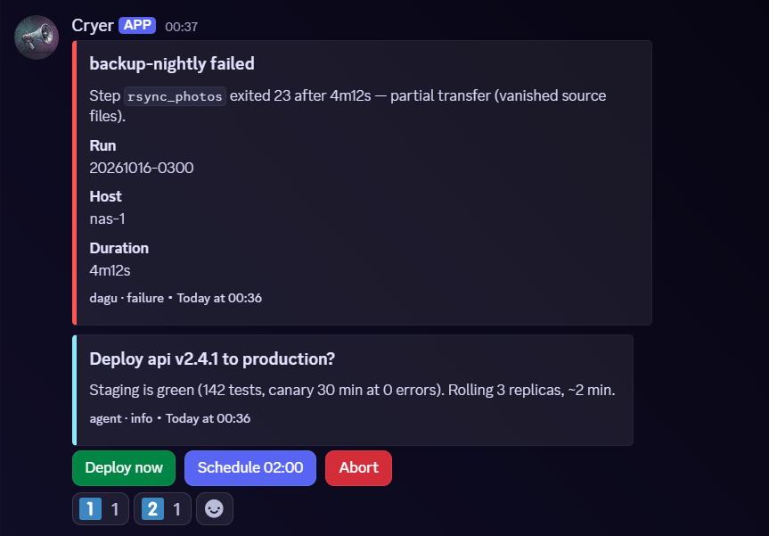

# cryer

Discord notifications and decisions for your services: agents, cron jobs and services post embeds and
ask a human with buttons, reactions or replies — over HTTP, MCP or a CLI.



Notifications are routed to channels by source and level. A prompt carries up to 25 options as buttons
(an option may open a modal for free text), plus number reactions and reply matching; the first answer wins
across replicas and is handed back through a long-poll, an `http` callback or an
[opencode](https://opencode.ai) session. Ingest adapters accept [apprise](https://github.com/caronc/apprise)
and [dagu](https://github.com/dagu-org/dagu) webhooks, an MCP server exposes the same tools to agents,
and runtime settings live in the database. Several replicas share an [rqlite](https://rqlite.io) store.
Features, configuration, API and operations are documented in [`docs/`](docs/).

## Requirements

- [Bun](https://bun.sh) 1.4 (to run from source) or Docker with Compose.
- A Discord application with a bot token, invited to your server with *Send Messages*, *Embed Links*,
  *Add Reactions* and *Read Message History*; the channel ids notifications should land in.
- Optional: the **Message Content** privileged intent for reply answers (reactions and buttons work without it).
- Optional: an [rqlite](https://rqlite.io) cluster to run more than one replica.
- Optional: a public HTTPS hostname that forwards `/interactions` to cryer, for buttons and modals.

## Setup

1. Create the Discord application in the [Developer Portal](https://discord.com/developers/applications):
   New Application → **Bot** → Reset Token (→ `DISCORD_TOKEN`). General Information gives the
   **Application ID** and **Public Key**. Invite the bot: OAuth2 → URL Generator → scope `bot` with the
   permissions above, open the URL, pick your server. For reply answers turn on Bot → Privileged Gateway
   Intents → **Message Content**.
2. Run it:

   ```sh
   git clone https://github.com/rojosinalma/cryer && cd cryer
   cp .env.example .env            # DISCORD_*, CRYER_API_TOKEN, DEFAULT_CHANNEL_ID at minimum
   docker compose up -d            # ghcr.io/rojosinalma/cryer, 127.0.0.1:7474, data in a volume
   # or from source: bun install && bun run start
   curl -s localhost:7474/health
   ```

3. Send the first message:

   ```sh
   export CRYER_API_TOKEN=…        # or put CRYER_URL/CRYER_API_TOKEN in ~/.config/cryer/env
   bin/cryer notify -l success -s hello "cryer is up" "first message"
   bin/cryer ask "Deploy v1.2?" -o yes=Deploy -o no=Skip --wait 120
   ```

4. For buttons and modals, once cryer is reachable from the internet: General Information →
   **Interactions Endpoint URL** = `https://<public-host>/interactions`. Discord sends a signed PING on
   save; cryer answers `{type:1}`. Expose **only** `/interactions` publicly — it is Ed25519-verified and
   needs no other gate. Keep the API, MCP, settings and ingest routes on your private network or behind an
   authenticating proxy.

## License

[MIT](LICENSE).
